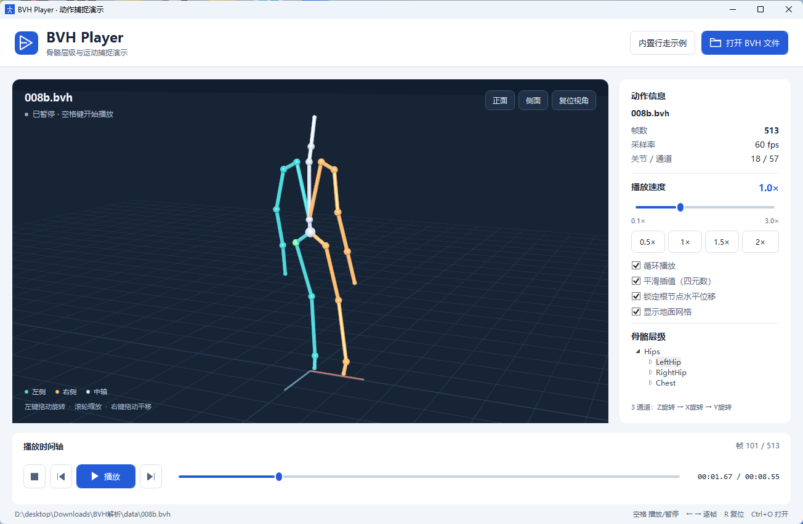

# BVH Player · 动作捕捉演示程序

使用 **C# / WPF / .NET 10** 实现的 Windows 三维 BVH 播放器。读取 BVH 文件、重建骨骼层级，并按文件中的帧间隔播放动作。本仓库直接包含未压缩的解决方案、工程文件、源码和示例数据。



## 功能

- 打开本地 `.bvh` 文件，支持拖放和命令行文件路径。
- 播放、暂停、停止、逐帧，以及拖动时间轴定位。
- **0.1×–3.0× 调速**，提供 0.5× / 1× / 1.5× / 2× 快捷按钮。
- 循环播放，可选四元数平滑插值。
- 三维骨架显示、鼠标旋转/缩放/平移，正面、侧面及复位视角。
- 显示帧数、采样率、关节数、通道数及骨骼层级树。
- 选择关节显示其运动通道顺序，并在视口中高亮。
- 可锁定根节点水平位移，以便居中观察动作。
- 内置原创生成的 BVH 行走示例，无需另外准备文件即可演示。

## 运行

面向 **Windows 10/11 x64**。发布版为自包含单文件 `BVHPlayer.exe`，目标电脑不需要安装 Unity 或 .NET SDK。首次启动需要将原生依赖解压到用户临时目录。

双击 exe 后显示内置示例，默认暂停。点击右上角“打开 BVH 文件”选择自己的动作文件，再点击“播放”。文件导入失败时显示错误并保留原先载入的动作。

```powershell
# 可选：启动时直接指定一个 BVH 文件
.\BVHPlayer.exe "D:\motions\walk.bvh"
```

| 操作 | 方法 |
|---|---|
| 打开 BVH | “打开 BVH 文件”、Ctrl+O，或拖入窗口 |
| 播放 / 暂停 | “播放 / 暂停”按钮或空格 |
| 停止并回首帧 | 方形停止按钮或 Home |
| 上一帧 / 下一帧 | 逐帧按钮或 ← / →（滑块与树控件保持其原生方向键操作） |
| 调整速度 | 右侧速度滑块或倍率按钮 |
| 定位帧 | 拖动底部时间轴 |
| 旋转相机 | 在视口按住左键拖动 |
| 缩放 | 在视口滚动鼠标滚轮 |
| 平移相机 | 在视口按住右键或中键拖动 |
| 复位相机 | “复位视角”或 R |

## 打开工程与编译

开发环境：Windows x64、支持 .NET 10 的编辑器、**.NET 10 SDK**。可以直接用 Visual Studio 或 Rider 打开根目录的 `BVHPlayer.sln`，也可以执行以下命令。无需额外 NuGet 图形库或 Unity 插件。

```powershell
dotnet build BVHPlayer.sln -c Release
dotnet run --project src/BvhPlayer.App -c Release
```

发布自包含 exe：

```powershell
dotnet publish src/BvhPlayer.App -c Release -r win-x64 --self-contained true -o artifacts/win-x64
```

也可以使用一体化脚本编译、测试和发布：

```powershell
.\build.ps1 -Publish

# 发布后将 exe 复制到当前用户桌面
.\build.ps1 -CopyToDesktop

# 使用外部目录中的 BVH 文件增加集成测试
.\build.ps1 -Publish -SampleDirectory "D:\motions"
```

开发版运行期间重新编译前，请先关闭开发版窗口，避免 Windows 锁定 exe 文件。发布结果位于 `artifacts/win-x64/BVHPlayer.exe`。

## 目录结构

```text
BVHPlayer.sln
Directory.Build.props
build.ps1
src/
  BvhPlayer.Core/          BVH 解析、姿态计算、播放时钟
  BvhPlayer.App/           WPF 界面和原生三维渲染
tests/
  BvhPlayer.Tests/         核心测试、输入校验、独立姿态参考算法
  BvhPlayer.UiSmoke/       实际 Windows 窗口的自动化操作测试
samples/
  studio-walk.bvh          原创合成动作，随 exe 内嵌
tools/
  generate_demo.py         可重新生成示例的脚本
docs/
  implementation.md       BVH 处理及程序设计说明
  validation.md           实际验证记录
```

## 测试

```powershell
# 核心测试及内置示例
dotnet run --project tests/BvhPlayer.Tests -c Release -- samples/studio-walk.bvh

# 额外验证自己的整个 BVH 数据目录
dotnet run --project tests/BvhPlayer.Tests -c Release -- "D:\motions"

# Windows 实际界面测试，测试后保留主窗口供检查
dotnet run --project tests/BvhPlayer.UiSmoke -c Release -- "artifacts/win-x64/BVHPlayer.exe" "D:\motions\walk.bvh"
```

测试输出写入本地 `TestResults/`。实际课件样例验证记录见 [验证说明](docs/validation.md)。

## BVH 格式处理

解析 `HIERARCHY`、`ROOT`、`JOINT`、`OFFSET`、`CHANNELS`、`End Site` 和 `MOTION`。按深度优先顺序分配通道，并严格使用声明的通道顺序组合变换。所有位置通道（包括非根节点的位置通道）和根节点 OFFSET 均参与计算。插值使用局部姿态四元数 slerp，不直接对欧拉角做线性插值。

屏幕显示统一缩放骨架和位移；原始 BVH 文件不会被修改。默认采用 Y 轴向上；仅显示骨架，不进行蒙皮或人物网格重定向。更多细节见 [实现说明](docs/implementation.md)。

## 数据说明

仓库中的 `studio-walk.bvh` 由 `tools/generate_demo.py` 生成。课件、视频、原课程 C++ 工程和课程提供的 BVH 数据仅用于本地参考与验证，不收录在本仓库中。使用自己的 BVH 文件时请保留其来源与授权信息。
