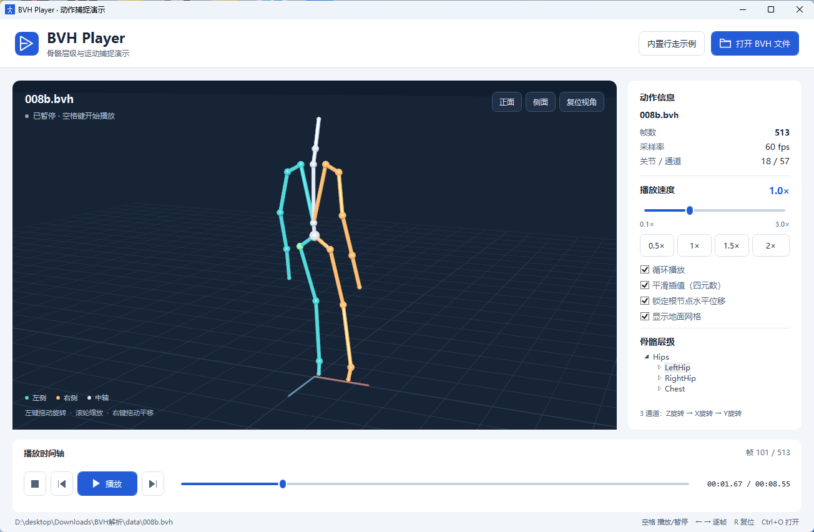
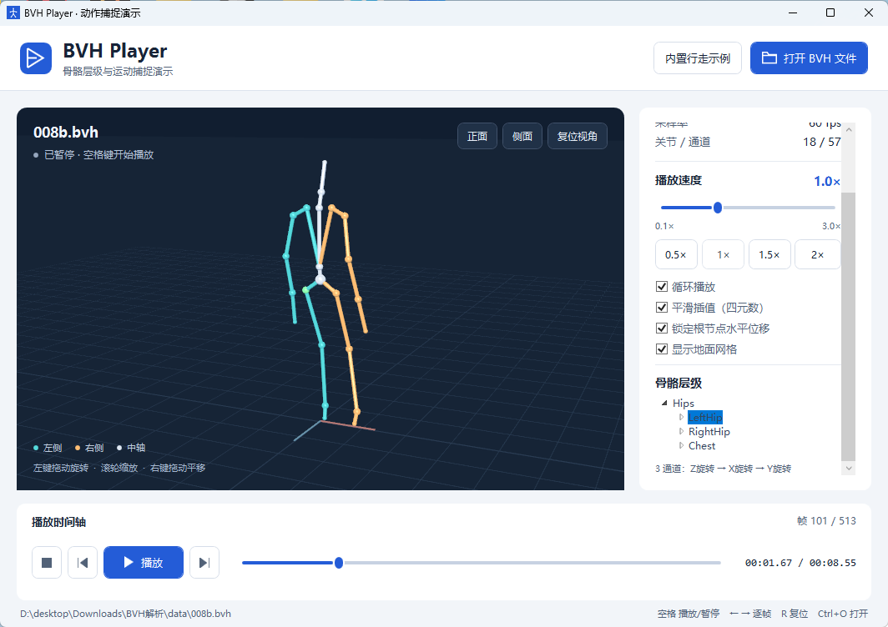

# 验证记录

验证日期：2026 年 11 月 12 日。环境：Windows x64、.NET SDK 10.0.201。最终使用桌面上的自包含 `BVHPlayer.exe` 执行界面测试。

## 核心检查

执行：

```powershell
dotnet run --project tests/BvhPlayer.Tests -c Release --no-build -- "D:\desktop\Downloads\BVH解析\data" "samples\studio-walk.bvh"
```

结果：**35 项通过，0 项失败，退出码 0**。包括格式解析、父子关系、End Site、非交换旋转顺序、非根节点平移、根 OFFSET、四元数短弧插值、播放/暂停/调速、定位、循环、末尾停止和非法输入拒绝。

全部 11 个课件 BVH 文件通过解析；每个文件逐帧检查插值姿态为有限数值，并在多个关键帧用独立的 double 精度列向量算法核对。内置原创示例也通过相同集成检查。

| 文件 | 帧数 | 动画关节数 | 通道数 | 原始采样率 |
|---|---:|---:|---:|---:|
| 008b.bvh | 513 | 18 | 57 | 约 60 fps |
| 012.bvh | 886 | 18 | 57 | 约 60 fps |
| 035.bvh | 316 | 18 | 57 | 约 60 fps |
| 041.bvh | 312 | 18 | 57 | 约 60 fps |
| 057.bvh | 385 | 18 | 57 | 约 60 fps |
| 073.bvh | 1761 | 18 | 57 | 约 60 fps |
| 076.bvh | 2179 | 18 | 57 | 约 60 fps |
| KICK R.bvh | 514 | 18 | 57 | 约 60 fps |
| walk1.bvh | 8531 | 27 | 84 | 约 120 fps |
| walk2.bvh | 1631 | 27 | 84 | 约 120 fps |
| walk3.bvh | 1383 | 27 | 84 | 约 120 fps |
| studio-walk.bvh | 240 | 19 | 60 | 60 fps |

原输入的 SHA256、帧间隔和实际测试结果保存在 [core-results.json](validation/core-results.json)，原始控制台记录保存在 [core-run.log](validation/core-run.log)。课件和数据文件只读，没有被本工程修改。

## 编译与发布

```powershell
dotnet build BVHPlayer.sln -c Release --nologo
dotnet publish src/BvhPlayer.App -c Release -r win-x64 --self-contained true -o artifacts/win-x64 --nologo
```

编译结果：**0 个警告、0 个错误，退出码 0**。发布结果为单个自包含 exe，运行时依赖内嵌。原始输出见 [build.log](validation/build.log) 和 [publish.log](validation/publish.log)。发布文件与桌面副本的 SHA256 一致，具体校验值在 [release.json](validation/release.json) 中记录。

## 实际界面检查

```powershell
dotnet run --project tests/BvhPlayer.UiSmoke -c Release --no-build -- "D:\desktop\BVHPlayer.exe" "D:\desktop\Downloads\BVH解析\data\008b.bvh"
```

结果：**19 项通过，0 项失败，退出码 0**。

- 停止回到首帧、时间轴定位、上一帧和下一帧。
- 1× 播放推进帧号，暂停期间帧号保持不变，2× 播放在相同实际时间内约推进两倍帧数。
- 速度滑块可以达到 0.1× 和 3×，1× 快捷按钮生效。
- 正面、侧面、复位相机操作后程序响应正常。
- 关闭循环后停在末帧，再次播放可从头开始。
- 通过真实系统文件对话框打开 008b.bvh，导入后可以定位帧。
- 错误 BVH 文件显示错误提示，程序没有崩溃。
- 在 1080 × 760 最小窗口中，滚动侧栏后可操作骨骼树，选中关节后显示对应通道顺序。

原始输出见 [ui-run.log](validation/ui-run.log)，结构化检查列表见 [ui-results.json](validation/ui-results.json)。测试使用系统 UI Automation 调用实际窗口控件；核心运算另由独立测试程序覆盖。界面自动化不等于在所有 Windows 机器上完成兼容性测试。

## 界面预览

默认窗口与最小窗口分别检查主操作区和控件布局。下图来自实际 exe，而非界面设计稿。



最小窗口中，侧栏滚动到骨骼层级后仍可选择关节并查看通道信息：



## 验证中解决的问题

- Windows 在开发版运行时锁定 exe：关闭本次测试进程后重新编译，最终编译通过。
- 初版测试脚本只查找根层窗口，漏掉系统文件对话框：改为查找当前进程的后代窗口。
- 系统文件对话框中，文件列表项和“打开”按钮均可能具有自动化编号 `1`：增加按钮类型条件，并验证实际载入的文件名。
- 调整视角默认距离与侧栏布局后，重新发布桌面 exe 并重新执行界面检查。

## 范围

已验证上述输入、主要播放控件和本机界面。默认 Y 轴向上；没有人物蒙皮、骨骼重定向或修改原文件功能。地面高度来自采样包围盒估计，不保证每个动作全程足底贴地。程序未做数字签名，未在其他电脑或其他 Windows 架构上运行验证。
